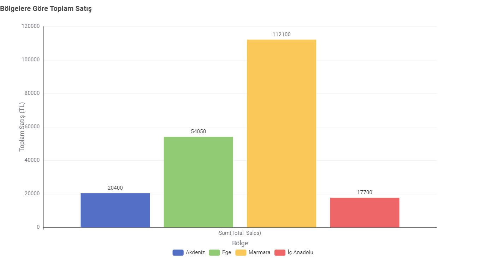
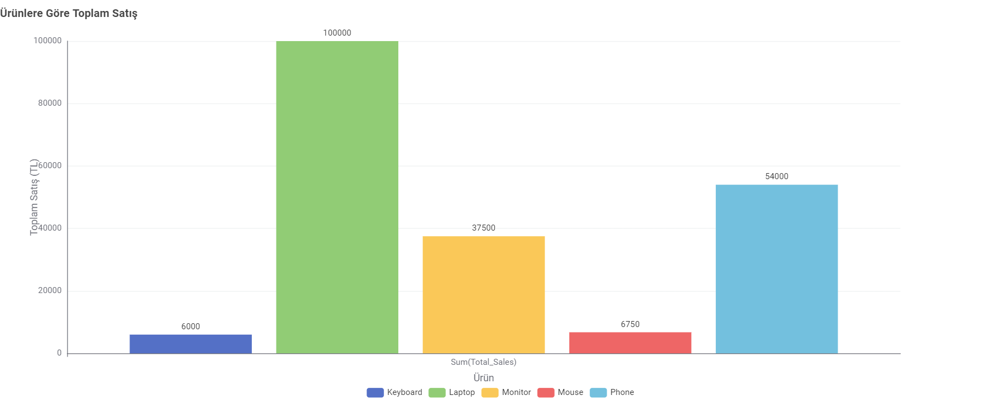

# E-Commerce Sales Analysis with KNIME

## Project Overview
This project focuses on analyzing e-commerce sales data using KNIME Analytics Platform. The aim is to explore sales performance across product categories, products, and regions.

## Tools & Technologies
- KNIME Analytics Platform
- CSV
- Data Cleaning and Transformation
- Data Aggregation
- Data Visualization

## Workflow
The analysis includes the following steps:

1. Imported sales data using CSV Reader.
2. Checked missing values using Missing Value.
3. Calculated total sales using Math Formula (Quantity × Unit Price).
4. Aggregated sales by category, product, and region using GroupBy.
5. Ranked products by total sales using Sorter.
6. Visualized sales performance using Bar Chart.

## Key Findings

### Sales by Category
- Electronics: 191,500
- Accessories: 12,750

### Sales by Product
- Laptop: 100,000
- Phone: 54,000
- Monitor: 37,500
- Mouse: 6,750
- Keyboard: 6,000

### Sales by Region
- Marmara: 112,100
- Ege: 54,050
- Akdeniz: 20,400
- Central Anatolia: 17,700

  ## Visualizations

### Sales by Region

### Sales by Product

## Dataset
The project uses a sample e-commerce sales dataset created for learning and analysis purposes.

## Project Type
Personal Learning Project
